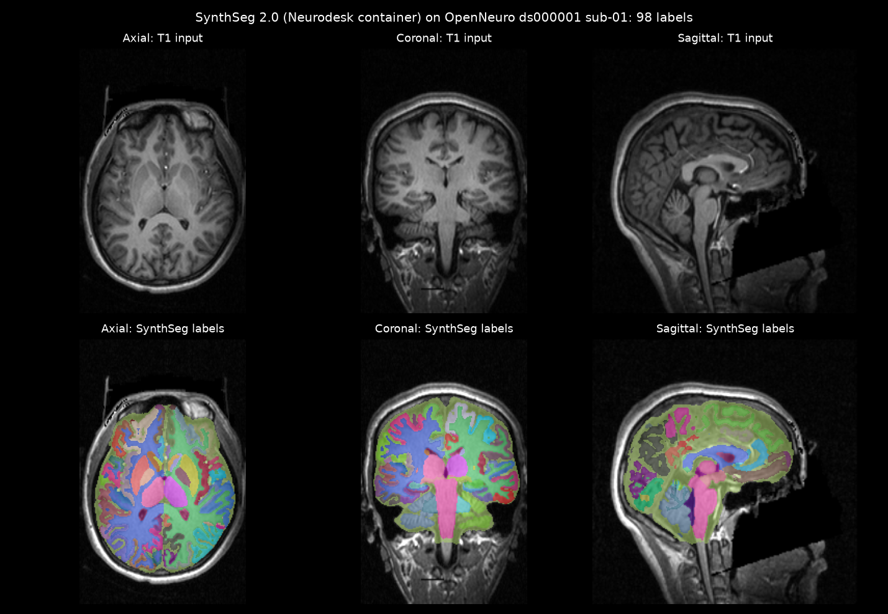

# Neurodesk demo

Notes and a worked example for demonstrating [Neurodesk](https://neurodesk.org), a platform of
containerised neuroimaging tools.

Sources:
- Applications: https://neurodesk.org/overview/applications/
- GitHub: https://github.com/NeuroDesk (neurodesktop, neurocommand, neurocontainers)
- Hosted options: https://neurodesk.org/getting-started/hosted/
- Windows install: https://neurodesk.org/getting-started/neurodesktop/windows/

## What Neurodesk offers

Neurodesktop is a browser-based Linux desktop (JupyterLab plus a remote desktop) that gives
access to the Neurodesk catalogue of about 340 tools, such as FSL, FreeSurfer, MRtrix3,
ITK-SNAP, MRIcroGL, 3D Slicer and fMRIPrep. Each tool downloads on demand when first opened.

## Option A: hosted, no install (preferred for demos)

### A1. Neurodesk Play (full environment)
- Australia: https://play.neurodesk.cloud.edu.au (AAF sign-in)
- US: https://play-america.neurodesk.org, Europe: https://play-europe.neurodesk.org
  (GitHub sign-in, first-time approval averages 24 hours)
- Free, but with resource limits (quotas not published). Suitable for a demo, not heavy processing.

### A2. Neurodesk Webapps (runs in the browser)
- Directory: https://webapps.neurodesk.org/
- Per the Neurodesk docs, files are processed in the browser and are not uploaded.
- Quick demos: SynthSeg (https://webapps.neurodesk.org/synthseg/), Brain2Print, Deface, NiiMath.
- Load `sample_data/sub-01_T1w.nii.gz` from this repo.

## Sample data

`sample_data/sub-01_T1w.nii.gz` (5.5 MB, T1-weighted MRI, face removed) is from
OpenNeuro ds000001, "Balloon Analog Risk-taking Task", licence CC0,
DOI [10.18112/openneuro.ds000001.v1.0.0](https://doi.org/10.18112/openneuro.ds000001.v1.0.0).
Source: https://s3.amazonaws.com/openneuro.org/ds000001/sub-01/anat/sub-01_T1w.nii.gz

## Worked example: SynthSeg with the Neurodesk container

Run on 14 October 2026 with image `vnmd/synthseg_8.2.1:20260916` (about 4 GB download,
SynthSeg 2.0). It took about 50 seconds on CPU.

```bash
docker run --rm -v "$PWD/sample_data:/in:ro" -v "$PWD/output:/out" vnmd/synthseg_8.2.1:20260916 \
  mri_synthseg --i /in/sub-01_T1w.nii.gz --o /out/sub-01_synthseg.nii.gz --parc \
  --vol /out/volumes.csv --qc /out/qc.csv --resample /out/sub-01_T1w_resampled.nii.gz --cpu --threads 16
```

Docker writes the outputs as root. To return ownership to your user:

```bash
docker run --rm -v "$PWD/output:/out" --entrypoint chown vnmd/synthseg_8.2.1:20260916 -R $(id -u):$(id -g) /out
```

Outputs in `output/`:

| File | Content |
|---|---|
| `sub-01_synthseg.nii.gz` | Segmentation with 98 labels (subcortical structures plus cortical parcellation) |
| `sub-01_T1w_resampled.nii.gz` | Input scan resampled to the segmentation grid |
| `volumes.csv` | Volume of each region |
| `qc.csv` | Automated quality scores (0.76 to 0.95 for this scan) |
| `synthseg_preview.png` | Axial, coronal and sagittal views with labels overlaid |



To recreate the preview image:

```bash
python3 -m venv .venv && .venv/bin/pip install -r scripts/requirements.txt
.venv/bin/python scripts/preview.py output/sub-01_T1w_resampled.nii.gz \
  output/sub-01_synthseg.nii.gz output/synthseg_preview.png
```

## Option B: Neurodesktop locally with Docker (PowerShell on Windows)

Requires Docker Desktop. To use Docker from WSL, turn on
Settings > Resources > WSL Integration for your Ubuntu distro.

```powershell
docker volume create neurodesk-home
docker run --shm-size=1gb -it --privileged --user=root --name neurodesktop `
  -v C:/neurodesktop-storage:/neurodesktop-storage `
  --mount source=neurodesk-home,target=/home/jovyan `
  --add-host=host.docker.internal:host-gateway `
  -e OLLAMA_HOST="http://host.docker.internal:11434" `
  -p 8888:8888 -e NEURODESKTOP_VERSION=2026-09-23 vnmd/neurodesktop:2026-09-23
```

1. Open the `http://127.0.0.1:8888/lab?token=...` URL printed in the terminal.
   Use Chrome or Edge, not Firefox.
2. Click "Desktop Auto-Resolution", then pick a tool from the Neurodesk menu.
3. Ctrl+C in the terminal stops it. Restart later with `docker start -i neurodesktop`.

## Suggested demo flow (not yet rehearsed)
1. Show the Neurodesk application catalogue (categories, versioned containers).
2. Open https://webapps.neurodesk.org/synthseg/ and run it on the sample scan.
3. Show `output/synthseg_preview.png` and `volumes.csv` as the expected result, or as a fallback.

## Credits and licences
- Sample data: OpenNeuro ds000001 (CC0). Schonberg et al. (2012), *Frontiers in Neuroscience*,
  6:80, doi:[10.3389/fnins.2012.00080](https://doi.org/10.3389/fnins.2012.00080).
- SynthSeg: Billot et al. (2023), "SynthSeg: Segmentation of brain MRI scans of any contrast and
  resolution without retraining", *Medical Image Analysis* (citation as printed by the tool).
  The container includes FreeSurfer components under the
  [FreeSurfer Software License](https://surfer.nmr.mgh.harvard.edu/fswiki/FreeSurferSoftwareLicense).
- Neurodesk: https://neurodesk.org
